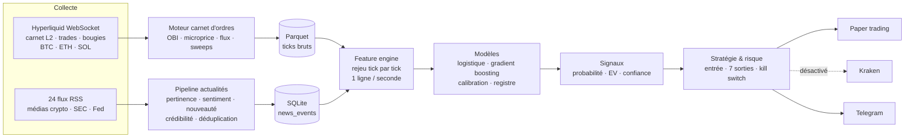
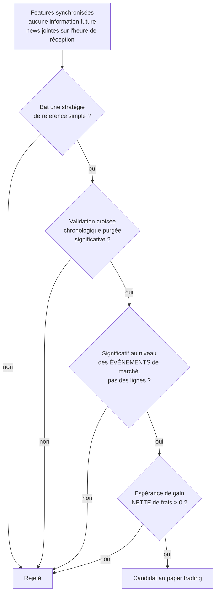

# NewsRadar MSSE — Crypto News Radar & Microstructure Scalping Engine


Système de **recherche quantitative** qui cherche à mesurer, avec une
méthodologie statistique stricte, s'il existe un véritable **edge** sur
les marchés crypto en combinant deux sources d'information : le **flux
d'actualités** (24 flux RSS, dont la SEC et la Fed) et la
**microstructure du carnet d'ordres** (Hyperliquid, en temps réel).

> ⚠️ Projet personnel de recherche. Ce n'est **pas** un conseil en
> investissement. Aucun ordre réel n'a été passé : l'exécution Kraken est
> livrée désactivée par conception.

> 🧪 **Statut : recherche conclue, projet arrêté le 29/08/2026.** Voir
> [Objectif et conclusion](#objectif-et-conclusion).

---

## Objectif et conclusion

Ce projet fait suite à [**CRTxICT Crypto**](https://github.com/Lxboi/CRTxICT_Crypto),
qui avait montré qu'une stratégie de trading discrétionnaire populaire ne
procure pas d'avantage mesurable une fois codée et testée honnêtement.
La question devenait : **où un véritable edge pourrait-il se trouver, et
comment le prouver sans se tromper soi-même ?**

L'approche retenue ici est l'inverse d'une stratégie « intuitive » :
partir des données brutes (chaque mise à jour du carnet d'ordres, chaque
transaction, chaque actualité), estimer des **probabilités** de
mouvement de prix à très court terme, et n'accepter un résultat qu'après
une série de contrôles de plus en plus exigeants.

**Le constat est clair :**

- Un edge **directionnel** statistiquement réel existe, mais uniquement
  sur de très petits mouvements (10 à 25 points de base, sur 1 à 5
  minutes), pour BTC et ETH.
- Cet edge est **5 à 10 fois plus petit que les coûts de transaction**
  réels (frais aller-retour de 86 à 166 pb sur Kraken). Même sur
  Hyperliquid, 10 à 27 fois moins cher, l'espérance de gain nette de
  frais reste **négative dans toutes les configurations testées**.
- Ni un modèle fondé sur les seules actualités, ni un modèle capable de
  découvrir des interactions actualités × microstructure, n'ont changé
  ce résultat.

Autrement dit : prédire correctement la *direction* d'un mouvement ne
suffit pas ; il faut que son *amplitude* couvre les coûts, et ce n'est
pas le cas. Le projet s'est arrêté sur ce résultat négatif, documenté et
reproductible, plutôt que de chercher à forcer un backtest favorable.

---

## Architecture



**Répartition sur deux machines** pendant la recherche : un Raspberry Pi
collectait les données en continu (sans aucune clé API), le PC
construisait les features, entraînait et évaluait les modèles.

## Le protocole de validation

Le cœur du projet est un entonnoir de contrôles. Chaque étape élimine
une source classique de faux positif :



- **Pas d'information future** : les actualités sont jointes sur leur
  heure de *réception*, jamais sur l'heure qu'elles annoncent ; des tests
  vérifient que mélanger ou supprimer des données futures ne modifie
  aucune feature passée.
- **Validation croisée purgée** : découpage strictement chronologique,
  avec une zone tampon de la durée de l'horizon de prédiction à chaque
  frontière ; jamais de découpage aléatoire.
- **Niveau événement** : échantillonnées chaque seconde, les lignes
  consécutives d'un même mouvement de marché ne sont pas indépendantes.
  Ce contrôle regroupe les lignes en événements et refait le test
  statistique sur ces seuls événements. Il a éliminé deux faux positifs
  spectaculaires (ex. 120 des 146 « réussites » d'un modèle SOL
  concentrées dans deux courtes fenêtres, dont une de 145 secondes :
  quelques mouvements de marché comptés comme une centaine d'essais
  indépendants).
- **Espérance nette de frais** : le test final, avec les coûts réels de
  chaque plateforme.

## Résultats

Edges directionnels ayant survécu au contrôle au niveau événement
(données du 21 au 28/08/2026) :

| Actif | Horizon / seuil | Événements | Précision | p-value |
|---|---|---|---|---|
| BTC | 60 s / 10 pb | 88 | 65,9 % | 0,002 |
| ETH | 60 s / 10 pb | 169 | 62,1 % | 0,001 |
| BTC | 300 s / 15 pb | 64 | 68,0 % | 0,002 |
| ETH | 300 s / 15 pb | 162 | 61,1 % | 0,003 |
| BTC | 300 s / 25 pb | 35 | 71,4 % | 0,008 |

SOL ne passe pas ce contrôle (p = 0,074). Au-delà de 50 pb, plus rien
ne survit ; au-delà de 75 pb, il n'y a même plus assez d'exemples pour
entraîner un modèle.

**Confrontation aux coûts**, au tarif le plus bas trouvé (Hyperliquid,
ordres maker, ~9 pb aller-retour) :

| Configuration | Gain brut moyen estimé* | Espérance nette | p-value |
|---|---|---|---|
| BTC 60 s / 10 pb | ~1,5 pb | -7,5 pb | 1,0 |
| ETH 60 s / 10 pb | ~1,1 pb | -7,9 pb | 1,0 |
| BTC 300 s / 15 pb | ~5,8 pb | -3,2 pb | 1,0 |
| ETH 300 s / 15 pb | ~2,5 pb | -6,5 pb | 1,0 |
| BTC 300 s / 25 pb | ~8,8 pb | -0,17 pb | 0,59 |

\* Gain brut = espérance nette + coût aller-retour.

| Plateforme | Coût aller-retour |
|---|---|
| Kraken Pro (taker / maker) | ~166 pb / ~86 pb |
| Hyperliquid (taker / maker) | ~15 pb / ~9 pb |

Le meilleur cas est indiscernable de zéro (p = 0,59) ; tous les autres
sont nettement négatifs.

**Limites** : environ une semaine de données exploitables, sur un seul
régime de marché, pour trois actifs. Le résultat dit qu'aucun edge
exploitable n'apparaît dans ces conditions, pas qu'il ne peut en exister
aucun.

## Points techniques

- **Pipeline temps réel asynchrone** (`asyncio`) : chaque source est une
  tâche indépendante ; la panne d'un flux n'affecte jamais les autres.
- **Moteur de carnet d'ordres** : déséquilibre (OBI) sur 1/5/10/25
  niveaux, microprice et sa dérivée, flux de transactions sur plusieurs
  fenêtres, murs de liquidité, détection de sweeps et d'absorption.
- **Radar d'actualités** : 24 flux RSS respectant `robots.txt`,
  classification, sentiment lexical, pertinence par mots-clés avec
  frontières de mots, nouveauté, crédibilité, décroissance temporelle.
- **Modèles** : régression logistique et gradient boosting, calibration
  (Platt / isotonique), registre append-only où la mise en production
  d'un modèle est toujours manuelle et justifiée.
- **Backtest** : chronologique sans regard vers le futur, coûts réalistes,
  Sharpe/Sortino/drawdown, bootstrap, Monte Carlo, probabilité de ruine,
  walk-forward purgé.
- **Sécurité d'exécution** : paper trading derrière deux verrous
  indépendants ; client Kraken derrière trois verrous, tous désactivés
  par défaut. Aucun code du projet ne peut passer un ordre réel sans une
  action explicite.
- **Qualité** : 753 tests `pytest`, tous hors ligne (aucun accès réseau),
  intégration continue GitHub Actions et scan de secrets.

## Démarrage rapide

```bash
git clone https://github.com/Lxboi/NewsRadar_MSSE.git
cd NewsRadar_MSSE
python -m venv .venv
source .venv/bin/activate        # Windows : .venv\Scripts\activate
pip install -e ".[dev]"

cp .env.example .env             # aucune clé n'est nécessaire en mode recherche
python -m pytest -q              # 753 tests, sans réseau
python -m src.main               # collecte en direct + affichage console
```

En mode `RESEARCH` (par défaut), le programme se connecte à Hyperliquid
et aux flux RSS, affiche le carnet d'ordres et les actualités pertinentes
en direct, et enregistre les données dans `data/` (exclu du dépôt).

Pour reproduire la recherche : `scripts/build_feature_table.py` (table
de features), puis `scripts/train_model.py` (entraînement, validation
croisée purgée, contrôle au niveau événement, espérance nette de frais
avec `--round-trip-cost-bps`). La méthode complète est décrite dans
[`docs/21_paper_trading_methodology.md`](docs/21_paper_trading_methodology.md).

## Documentation

| Document | Contenu |
|---|---|
| [`ROADMAP.md`](ROADMAP.md) | Journal complet des 15 phases et de chaque expérience, avec ses résultats |
| [`docs/03`](docs/03_hyperliquid_ws_architecture.md) · [`04`](docs/04_orderbook_engine.md) | Collecte Hyperliquid, moteur de carnet d'ordres |
| [`docs/10`](docs/10_news_radar.md) · [`11`](docs/11_news_market_sync.md) | Radar d'actualités, synchronisation des horloges |
| [`docs/12`](docs/12_feature_engine.md) · [`13`](docs/13_baseline_strategies.md) · [`14`](docs/14_statistical_models.md) | Features, stratégies de référence, modèles |
| [`docs/15`](docs/15_backtesting.md) · [`16`](docs/16_signals_and_strategy.md) · [`17`](docs/17_risk_and_telegram.md) | Backtest, signaux, risque et Telegram |
| [`docs/18`](docs/18_paper_execution.md) · [`19`](docs/19_kraken_executor.md) · [`20`](docs/20_live_paper_trading.md) | Exécution simulée, client Kraken, paper trading en direct |
| [`docs/22`](docs/22_raspberry_pi_data_collection.md) | Collecte sur Raspberry Pi |

La documentation technique détaillée est en anglais.

## Organisation du code

```text
config/     configuration YAML (actifs, sources, stratégie, Telegram) — aucun secret
src/        collectors · orderbook · news · features · models · signals ·
            strategy · backtest · execution · notifications · monitoring ·
            storage · live · main.py
scripts/    construction des features, entraînement, balayage de seuils
tests/      753 tests pytest
docs/       documentation technique
deploy/     service systemd pour la collecte sur Raspberry Pi
```

## Stack

Python 3.12 · asyncio · websockets · httpx · pandas · NumPy · SciPy ·
scikit-learn · statsmodels · PyArrow · SQLAlchemy · python-telegram-bot ·
pytest · GitHub Actions

## Auteur

**Enzo-LIBOÏ** — [LinkedIn](https://www.linkedin.com/in/enzo-libo%C3%AF/) · [GitHub](https://github.com/Lxboi)
